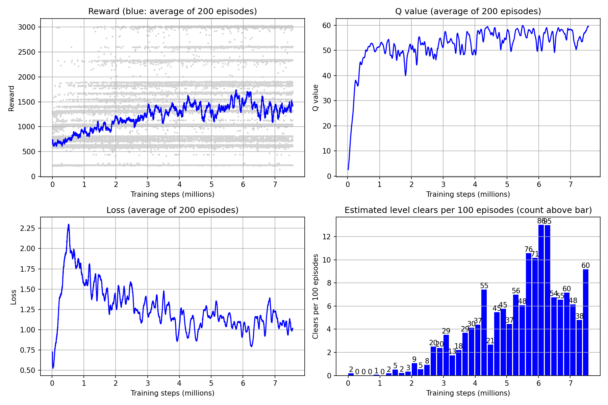

# Mario with Double DQN

An agent that learns to play **Super Mario Bros World 1-1 from raw pixels**, built from scratch in PyTorch with **Double DQN**. It follows the PyTorch tutorial *Train a Mario playing RL Agent*, but every part is written and organised as a standalone project: image preprocessing, the Q network, replay memory, the learning step, a resumable training loop with checkpoints and logging, an evaluation script, plots, and a script to watch the agent play.

After **7.56 million training steps** over 33,244 episodes (roughly 40 hours on a Mac M2), the final agent **clears World 1-1 every time it plays greedily**, in 491 steps with a reward of 3,023.

Built on the [Flappy Bird DQN walkthrough](../../../Module_7_Reinforcement_Learning/04_Deep_Q_Networks/Flappy_Bird_DQN), which introduces the DQN that this project extends to Double DQN.

## Contents

1. [Results at a glance](#1-results-at-a-glance)
2. [The problem](#2-the-problem)
3. [Background: from Q learning to Double DQN](#3-background-from-q-learning-to-double-dqn)
4. [Project structure](#4-project-structure)
5. [How it all fits together](#5-how-it-all-fits-together)
6. [The environment package](#6-the-environment-package)
7. [The agent package](#7-the-agent-package)
8. [Configuration](#8-configuration)
9. [Training: train.py](#9-training-trainpy)
10. [Evaluation and helper scripts](#10-evaluation-and-helper-scripts)
11. [Results](#11-results)
12. [Key findings](#12-key-findings)
13. [Limitations](#13-limitations)
14. [What comes next](#14-what-comes-next)
15. [How to run](#15-how-to-run)
16. [Troubleshooting](#16-troubleshooting)

---

## 1. Results at a glance

| Checkpoint | Epsilon | Episodes | Mean reward | Level clears |
|---|---|---|---|---|
| **latest (7.56M steps)** | **0** | 3 | **3,023** | **3 of 3** |
| latest (7.56M steps) | 0.05 | 30 | 1,815 | 7 of 30 |
| latest (3.86M steps) | 0 | 3 | 1,847 | 0 of 3 |
| latest (3.86M steps) | 0.05 | 30 | 1,549 | 1 of 30 |



---

## 2. The problem

At every moment Mario has to decide what to do next, and the only information is the screen. A good decision now (a jump) may only pay off many frames later (landing past a pit), and a bad one may only show its cost later too. This is a **sequential decision problem**, which is what reinforcement learning is built for.

The agent interacts with the game in a loop:

```
          state (what the screen looks like)
   ┌─────────────────────────────────────────┐
   │                                         ▼
 Game  ◄──────────── action ────────────  Agent
   │                                         ▲
   └─────────────────────────────────────────┘
          reward (how good that was) + done
```

* **State:** the last 4 frames of the screen, in grey, 84 by 84 pixels
* **Actions:** `right` or `right + jump`
* **Reward:** from the environment, per frame:
  * the distance moved to the right (positive) or left (negative)
  * minus the time that passed on the game clock
  * minus 25 on death, then clipped so every frame stays between -15 and +15
* **Episode end:** Mario dies, the clock runs out, or Mario touches the flag

A full clear of World 1-1 is worth about 3,000 (about 3,100 pixels of progress minus the time used).

---

## 3. Background: from Q learning to Double DQN

### Q values

A **Q value** `Q(s, a)` is the total future reward the agent expects if it takes action `a` in state `s` and plays well afterwards. If the agent knew the true Q values, playing well would be easy: always pick the action with the highest Q value.

Future rewards are discounted by `gamma` (0.9 here), so a reward 10 steps away counts about 0.9^10 ≈ 0.35 times as much as one right now. This keeps the agent focused on the near future and keeps the numbers finite.

### The TD target

Q values are learned with **temporal difference (TD)** learning. After one step the agent knows the reward it just got and the next state. The target for the old Q value is

```
target = reward + gamma * (best Q value of the next state)
```

and the network is trained to move `Q(s, a)` towards this target. If the episode ended, there is no future, so the second part is dropped. In the code this is done with `(1 - done)`.

TD is used instead of **Monte Carlo** (waiting until the episode ends and using the real total return) because Mario episodes are long, Monte Carlo returns are very noisy, and TD can learn from single stored steps taken at any time, which is exactly what replay memory needs.

### Why a neural network

The number of possible screens is astronomically large, so a table of Q values is impossible. A **convolutional neural network** takes the 4 stacked frames and outputs one Q value per action. Similar screens give similar Q values, so experience in one place helps in others.

### The two problems of plain DQN, and their fixes

1. **Consecutive steps are almost identical**, so training on them in order makes the network chase the most recent moments.
   **Fix: replay memory.** Every experience `(state, next_state, action, reward, done)` is stored, and training uses random batches from the whole memory.
2. **The target moves every time the network learns**, because the target is computed with the same network.
   **Fix: a target network.** A frozen copy of the network computes the targets and is refreshed from the trained network only every 10,000 steps.

### Double DQN

Plain DQN uses `max Q_target(next)` in the target. Taking the maximum of noisy estimates is biased upwards, so plain DQN tends to **overestimate** Q values. Double DQN splits the job between the two networks:

```
best_action = argmax Q_online(next_state)          # the online network picks
target      = reward + (1 - done) * gamma * Q_target(next_state, best_action)   # the target network scores
```

The online network chooses the action and the target network says how good it is, which removes most of that upward bias.

### Exploration: epsilon greedy

With probability epsilon the agent picks a random action, otherwise it picks the action with the highest Q value. Epsilon starts at 1 (fully random) and shrinks after every step until it reaches 0.1, so the agent explores a lot at first and relies on what it learned later.

### A worked example

Take a batch of 2 experiences with `gamma = 0.9`:

| | reward | done | Q_online(next) | best action | Q_target(next) | target |
|---|---|---|---|---|---|---|
| exp 1 | 1.0 | 0 | [2.0, 3.0] | 1 | [1.5, 2.5] | 1.0 + 0.9 × 2.5 = **3.25** |
| exp 2 | 2.0 | 1 | [4.0, 1.0] | 0 | [3.0, 0.5] | 2.0 + 0 = **2.0** |

The second experience ended the episode, so its future part is removed.

---

## 4. Project structure

```
Mario_Double_DQN/
├── train.py                 # trains the agent (smoke or full run)
├── evaluate.py              # plays the saved checkpoints, no learning
├── plot_results.py          # draws the training curves from the log
├── watch_mario.py           # opens a window and shows the agent playing
├── play_mario.py            # lets a person play World 1-1 with the keyboard
├── test_agent.py            # checks every method of the agent before training
│
├── environment/             # everything about the game and its preprocessing
│   ├── skip_frames.py       # SkipFrames: repeat each action for 4 frames
│   ├── grayscale.py         # GrayScale: colour screen to grey
│   ├── resize.py            # ResizeImage: shrink to 84 by 84, scale to 0 to 1
│   └── mario_env.py         # make_env(): builds the full wrapped game
│
├── agent/                   # everything about the learner
│   ├── network.py           # MarioNet: the online and target CNNs
│   ├── mario_agent.py       # Mario: act, remember, learn, save, load
│   └── logger.py            # MetricLogger: one CSV row per episode
│
├── config/
│   └── mario_parameters.yaml   # settings of the smoke and full runs
│
├── logs/                    # training_log_full.csv, training_log_smoke.csv
├── results/                 # eval_results.csv, training_curves.png
└── checkpoints/full/        # mario_latest.pt (the final agent, included in the repository)
```

Only `mario_latest.pt` is published, so `watch_mario.py` works straight after cloning. The best checkpoint and the smoke run stay local because of their size, so `evaluate.py` needs a training run of its own before it can test the best checkpoint.

**One rule keeps the imports simple:** every file you run sits in the top folder, and every file you import sits in a subfolder. Always run the scripts from the top folder, for example `python train.py full`. That is why imports look like `from agent.mario_agent import Mario`.

---

## 5. How it all fits together

### The state pipeline

Every frame from the game passes through four wrappers before the agent sees it. Each wrapper wraps the one before it, so the order matters.

```
NES emulator (gym-super-mario-bros)
   │  (240, 256, 3) colour, uint8, 12 buttons
   ▼
JoypadSpace            only 2 actions: right, right + jump
   ▼
SkipFrames(skip=4)     repeat the action 4 frames, add up the rewards
   ▼
GrayScale              (240, 256) grey, float32 tensor
   ▼
ResizeImage(84)        (84, 84), values 0 to 1
   ▼
FrameStack(4)          (4, 84, 84) LazyFrames  ──►  the state the agent sees
```

### One training step

```
                  ┌───────────────── Mario (agent/mario_agent.py) ─────────────────┐
 state ─────────► │ act(): epsilon greedy using the online network ──► action      │
                  │                                                                │
 env.step(action) │                                                                │
   ──► next_state, reward, done                                                    │
                  │ cache(): store (state, next_state, action, reward, done)       │
                  │                    │                                           │
                  │                    ▼                                           │
                  │           replay memory (50,000)                               │
                  │                    │ every 3rd step, after burn in             │
                  │                    ▼                                           │
                  │ learn() ─► recall(): random batch of 32                        │
                  │         ─► td_estimate(): Q_online(s, a)                       │
                  │         ─► td_target():   Double DQN target                    │
                  │         ─► update_q_online(): Smooth L1 loss, Adam step        │
                  │         ─► sync_q_target() every 10,000 steps                  │
                  └────────────────────────────────────────────────────────────────┘
```

### One training run

```
train.py full
  │
  ├─ read config/mario_parameters.yaml  (the "full" block)
  ├─ build env (make_env), agent (Mario), logger (MetricLogger)
  ├─ resume from checkpoints/full/mario_latest.pt if it exists
  │
  └─ for every episode:
        reset the game
        loop: act ─► step ─► cache ─► learn ─► until done
        log one row to logs/training_log_full.csv
        if the last 50 episodes beat the best average ─► save mario_best.pt
        every 20 episodes ─► save mario_latest.pt and print progress
     finally (also on Ctrl+C) ─► save mario_latest.pt
```

### Which script uses which file

| Script | Uses | Reads | Writes |
|---|---|---|---|
| `train.py` | `make_env`, `Mario`, `MetricLogger` | YAML config, latest checkpoint | checkpoints, training log |
| `evaluate.py` | `make_env`, `Mario` | best and latest checkpoints | `results/eval_results.csv` |
| `plot_results.py` | pandas, matplotlib | training log | `results/training_curves.png` |
| `watch_mario.py` | `make_env("human")`, `Mario` | latest checkpoint | nothing (opens a window) |
| `test_agent.py` | `make_env`, `Mario` | nothing | nothing (prints checks) |
| `play_mario.py` | the raw game | nothing | nothing (opens a window) |

---

## 6. The environment package

### `environment/skip_frames.py`: class `SkipFrames(gym.Wrapper)`

Neighbouring frames are almost identical, so deciding on every frame wastes effort. This wrapper repeats each action for `skip` frames.

* **`__init__(env, skip, render=False)`** stores how many frames to repeat, and whether to draw every frame on screen. `render` is only True when watching the agent.
* **`step(action)`** calls the game `skip` times with the same action and adds the rewards into one number. If the episode ends in the middle, it stops repeating, because stepping a finished game gives wrong results. When `render` is True it draws each frame after it is played, with a short `time.sleep(0.008)` so the game runs at a normal looking pace. It returns the last frame, the summed reward, `terminated`, `truncated` and `info`.

Result: the agent decides 4 times less often, and each decision has a visible effect.

### `environment/grayscale.py`: class `GrayScale(gym.ObservationWrapper)`

Colour is not needed to tell Mario, pipes and enemies apart, and dropping it makes the data 3 times smaller.

* A module level `transform = T.Grayscale()` is created once, not on every frame.
* **`__init__(env)`** updates `observation_space` from `(240, 256, 3)` to `(240, 256)`.
* **`observation(obs)`**
  1. reorders the array to `(3, 240, 256)`, the layout PyTorch image tools expect
  2. converts it to a float tensor (`copy()` is needed because the reordered array shares memory with the original)
  3. converts colour to grey, giving `(1, 240, 256)`
  4. removes the extra dimension, giving `(240, 256)`

### `environment/resize.py`: class `ResizeImage(gym.ObservationWrapper)`

A small square image is much cheaper for the network, and values between 0 and 1 keep the numbers inside it in a comfortable range.

* **`__init__(env, shape)`** accepts a single number (84 becomes `(84, 84)`) or a pair, updates `observation_space`, and builds two steps in a row: `T.Resize(shape, antialias=True)` and `T.Normalize(0, 255)`, which computes `(x - 0) / 255`.
* **`observation(obs)`** adds a channel dimension (`(1, 240, 256)`), applies both steps, and removes the channel again, giving `(84, 84)`.

### `environment/mario_env.py`: function `make_env(render_mode="rgb")`

Builds the whole processed environment in one call, so every script uses exactly the same game.

1. `gym.make("SuperMarioBros-1-1-v0", render_mode=render_mode, apply_api_compatibility=True)` creates the game. `apply_api_compatibility=True` converts the old 4 value `step` of this package into the 5 value format of gym 0.26 (`terminated` and `truncated` instead of one `done`).
2. `JoypadSpace` keeps only two button combinations: `["right"]` (action 0) and `["right", "A"]` (action 1).
3. `SkipFrames(skip=4, render=(render_mode == "human"))`
4. `GrayScale`
5. `ResizeImage(shape=84)`
6. `FrameStack(num_stack=4)` keeps the last 4 frames, so the network can see movement and direction, which one frame cannot show.

`render_mode="rgb"` (the default) is used for training and evaluation and draws nothing. `render_mode="human"` opens a window and is used only by `watch_mario.py`.

`import gym_super_mario_bros` looks unused, but importing it is what registers the Mario games inside gym so that `gym.make` can find them.

**A note on memory.** `FrameStack` returns `LazyFrames`, which store references to frames rather than copies. Consecutive states share 3 of their 4 frames, so the replay memory costs roughly one new 84 × 84 frame (about 28 KB) per experience instead of eight. They are only turned into real arrays for the 32 states sampled in each batch.

---

## 7. The agent package

### `agent/network.py`: class `MarioNet(nn.Module)`

The Q network. It holds two copies of the same CNN.

* **`__init__(input_dim, output_dim)`** checks that the frames are 84 by 84 (the layer sizes depend on it), then builds `self.online` and makes `self.target` as a `copy.deepcopy` of it. Every parameter of the target has `requires_grad = False`, so training never changes it directly. It only changes when the online weights are copied into it.
* **`forward(input, model)`** runs the input through `"online"` or `"target"`, and raises an error for any other name.

| Layer | Settings | Output shape |
|---|---|---|
| input | 4 stacked frames | (4, 84, 84) |
| Conv2d + ReLU | 32 filters, kernel 8, stride 4 | (32, 20, 20) |
| Conv2d + ReLU | 64 filters, kernel 4, stride 2 | (64, 9, 9) |
| Conv2d + ReLU | 64 filters, kernel 3, stride 1 | (64, 7, 7) |
| Flatten | | 3,136 |
| Linear + ReLU | | 512 |
| Linear | | 2 (one Q value per action) |

Each conv output size comes from `(input - kernel) / stride + 1`, for example `(84 - 8) / 4 + 1 = 20`.

Running `python agent/network.py` performs a self test: both outputs have shape `(1, 2)`, the target has 0 trainable parameters, and both copies give identical outputs at the start.

### `agent/mario_agent.py`: class `Mario`

The agent itself: it chooses actions, remembers experiences and learns from them.

**`__init__(state_dim, action_dim)`** sets up everything:

| Attribute | Value | Meaning |
|---|---|---|
| `gamma` | 0.9 | discount for future rewards |
| `memory` | `deque(maxlen=50000)` | replay memory, the oldest experiences drop out |
| `batch_size` | 32 | experiences per learning step |
| `loss_func` | `SmoothL1Loss` | gentle on large errors, such as the death penalty |
| `burnin` | 10,000 | experiences needed before learning starts |
| `learn_every` | 3 | learn on every 3rd step only |
| `sync_every` | 10,000 | steps between target network refreshes |
| `device` | mps, cuda or cpu | the fastest hardware available |
| `net` | `MarioNet` on the device | the online and target networks |
| `optimizer` | Adam, lr 0.00025 | created after the net, because it needs its parameters |
| `exploration_rate` | 1 | epsilon, starts fully random |
| `exploration_rate_decay` | 0.99999975 | default, replaced by the YAML value during training |
| `exploration_rate_min` | 0.1 | epsilon never goes below this |
| `curr_step` | 0 | how many actions have been taken |

Burn in exists because at the very start the memory only holds a few nearly identical moments from the beginning of the level, and learning from those would make the network memorise them. During burn in the agent only plays and stores, so it runs fast. Learning on every 3rd step keeps training about 3 times faster, and every experience is still reused many times because each update samples 32 from the whole memory.

**`act(state)`** chooses one action.
* With probability `exploration_rate`: a random action.
* Otherwise: turn the `LazyFrames` into an array, then a tensor of shape `(1, 4, 84, 84)` on the device, run the online network without gradients, and take the index of the highest Q value.
* Then epsilon shrinks: `max(exploration_rate_min, exploration_rate * exploration_rate_decay)`, and `curr_step` goes up by one.

**`cache(state, next_state, action, reward, done)`** appends one experience to memory. The states stay as `LazyFrames` to save memory.

**`recall()`** samples 32 random experiences and turns them into five tensors on the device:

| Tensor | Shape | dtype | Why |
|---|---|---|---|
| states | (32, 4, 84, 84) | float32 | network input |
| next_states | (32, 4, 84, 84) | float32 | network input |
| actions | (32,) | int64 | used as positions to pick Q values |
| rewards | (32,) | float32 | used in arithmetic |
| dones | (32,) | float32 | used as `(1 - done)` |

**`td_estimate(state, action)`** returns what the online network currently believes: it computes the Q values of all 32 states (shape `(32, 2)`) and keeps, for each row, the value of the action that was actually taken (shape `(32,)`). Gradients flow here, because this is the side that gets trained.

**`td_target(reward, next_state, done)`** returns the Double DQN label inside `torch.no_grad()`: the online network picks the best next action, the target network scores it, and the result is `reward + (1 - done) * gamma * next_q`.

**`update_q_online(td_estimate, td_target)`** is where learning happens: clear old gradients, compute the Smooth L1 loss, backpropagate, take one Adam step, and return the loss as a plain number.

**`sync_q_target()`** copies the online weights into the target network with `load_state_dict(online.state_dict())`.

**`learn()`** is called after every step and decides what should happen on that step. It always returns two values, so the caller can unpack it safely.
1. If `curr_step` is a multiple of `sync_every`, sync the target network. This is a plain `if`, so the checks below still run.
2. If the memory holds fewer than `burnin` experiences, return `(None, None)`. It checks the memory size rather than the step count, so it also works after resuming, when the memory starts empty again.
3. If `curr_step` is not a multiple of `learn_every`, return `(None, None)`.
4. Otherwise: `recall`, `td_estimate`, `td_target`, `update_q_online`, and return `(mean Q estimate, loss)` for logging.

**`save(path)`** writes one dictionary with four keys: `model` (both networks), `optimizer` (Adam's running averages, so a resumed run does not restart cold), `exploration_rate` and `curr_step`. It writes to `path + ".tmp"` first and then renames it over the real file with `os.replace`, so a crash in the middle of saving never destroys the previous checkpoint. The replay memory is not saved because it is several gigabytes.

**`load(path)`** reads the dictionary with `map_location=self.device` and restores all four parts.

### `agent/logger.py`: class `MetricLogger`

Records one CSV row per episode and keeps a rolling average of recent rewards.

* **`__init__(path)`** writes the header `episode, reward, length, avg_loss, avg_q, epsilon, step` only if the file does not exist yet, so a resumed run does not add a second header in the middle of the data. It also creates `recent_ep_rewards = deque(maxlen=50)`.
* **`log_episode(episode, reward, length, avg_loss, avg_q, epsilon, step)`** opens the file, appends one row and closes it again, so the data is safe on disk even if training is stopped at any moment. `None` values (no learning yet during burn in) become empty cells. It also adds the reward to the rolling window.
* **`rolling_average()`** returns the mean of the last 50 rewards, or 0.0 when there are none yet.

Running `python agent/logger.py` performs a self test that writes `test_logger.csv` and checks that rewards 10, 20 and 30 average to 20.0.

---

## 8. Configuration

`config/mario_parameters.yaml` holds one named block per run, so the same code runs a quick check or the real training.

| Field | smoke | full | Meaning |
|---|---|---|---|
| `num_episodes` | 30 | 50,000 | upper limit, the full run is stopped by hand |
| `print_every` | 1 | 20 | progress print interval in episodes |
| `save_every` | 5 | 20 | latest checkpoint interval in episodes |
| `burnin` | 500 | 10,000 | experiences before learning starts |
| `sync_every` | 500 | 10,000 | steps between target syncs |
| `exploration_decay` | 0.999 | 0.9999977 | epsilon multiplier per step |
| `checkpoint_dir` | `checkpoints/smoke` | `checkpoints/full` | where checkpoints go |
| `log_path` | `logs/training_log_smoke.csv` | `logs/training_log_full.csv` | where the log goes |

**Choosing the decay.** To bring epsilon from 1 to 0.1 in `N` steps, the decay is `0.1 ** (1 / N)`. The smoke test measured about 70 to 80 steps per second, so `N = 1,000,000` (about 4 hours) was chosen, giving `0.9999977`. The tutorial's default of 0.99999975 would need about 9.2 million steps.

---

## 9. Training: `train.py`

### class `Trainer`

**`__init__(param_set)`**
1. Reads the chosen block (`smoke` or `full`) from the YAML file.
2. Creates the checkpoint folder and the log folder if they do not exist.
3. Builds three paths inside the checkpoint folder: `mario_latest.pt`, `mario_best.pt` and `best_average.txt`.
4. Builds the environment with `make_env()`, the agent with `Mario((4, 84, 84), 2)` and the logger.
5. Overwrites the agent's default `burnin`, `sync_every` and `exploration_rate_decay` with the YAML values for this run.
6. **Resumes** from `mario_latest.pt` if it exists (weights, optimizer, epsilon and step counter), otherwise starts fresh.
7. Reads the best rolling average from `best_average.txt`, or starts at minus infinity, so a resumed run never replaces a good best model with a worse one.
8. Remembers the starting step and time, so steps per second only counts this session.

**`run()`** is the training loop, wrapped in `try / finally`.
* For each episode: reset the game and zero the counters, then repeat `act`, `env.step`, `cache`, `learn` until the episode ends, adding up the reward, the length, and the loss and Q value of the steps that learned.
* After each episode:
  * if `info["flag_get"]` is True, print that the level was finished
  * compute the average loss and Q value (or `None` during burn in) and log one row
  * if the 50 episode window is full and its average beats the best so far, save `mario_best.pt` and write the new value to `best_average.txt`
  * every `save_every` episodes save `mario_latest.pt`
  * every `print_every` episodes print the progress, including steps per second
* `finally` always saves `mario_latest.pt`, even after Ctrl+C or a crash.

### The `__main__` block

Checks that a run name was given (`python train.py smoke`), checks that the name exists in the YAML file and prints the valid names otherwise, then creates the `Trainer` and calls `run()`. A wrong command ends with `sys.exit(1)`, the code for "ended with a problem".

### Files produced

| File | Written when | Contains |
|---|---|---|
| `checkpoints/<run>/mario_latest.pt` | every `save_every` episodes and on exit | the most recent state |
| `checkpoints/<run>/mario_best.pt` | when the 50 episode average reaches a new best | the best state so far |
| `checkpoints/<run>/best_average.txt` | with `mario_best.pt` | that best average |
| `logs/training_log_<run>.csv` | after every episode | one row per episode |

### Resuming

Running the same command again resumes automatically. Three things to know:
* the replay memory is not saved, so the agent refills 10,000 experiences (about 2 minutes) before learning again
* the episode counter starts again at 1, which is why all plots use the `step` column on the x axis
* epsilon continues from its saved value instead of starting again at 1

---

## 10. Evaluation and helper scripts

### `evaluate.py`

Plays the saved checkpoints without any learning and measures how good they really are.

* **Settings at the top:** `CHECKPOINTS` (best and latest from `checkpoints/full`), `RUNS` (epsilon 0 for 3 episodes and epsilon 0.05 for 30), `MAX_STEPS = 5000` as a safety limit, and `RESULTS_PATH`.
* **`play(path, label, epsilon, num_episodes)`**
  1. builds the env and the agent and loads the checkpoint
  2. sets **both** `exploration_rate` and `exploration_rate_min` to the chosen epsilon. This matters: `act` never lets epsilon fall below the minimum, so with the minimum left at 0.1, an epsilon of 0 would silently turn into 0.1 after the first action
  3. plays the episodes and records the reward, the length and whether the flag was reached, without calling `cache` or `learn`
  4. checks that epsilon is unchanged at the end
  5. prints the mean, max and min reward, the mean length and the clears, and appends one row to `results/eval_results.csv`

**Why two epsilons?** The game is deterministic. With epsilon 0 the agent makes the same choices every time, so all episodes are identical and show the pure policy. Epsilon 0.05 adds a little randomness, which gives a real spread over 30 episodes.

### `plot_results.py`

Reads `logs/training_log_full.csv` with pandas and saves `results/training_curves.png` with four panels:
1. **Reward**, single episodes as grey dots and the 200 episode rolling mean as a line
2. **Q value**, 200 episode rolling mean
3. **Loss**, 200 episode rolling mean
4. **Estimated level clears per 100 episodes**, in blocks of 200,000 steps, with the count above each bar

The log has no flag column, so a clear is estimated as an episode with a reward of at least 2,900. The script also prints the total estimated clears and the count per block.

### `watch_mario.py`

Builds the game with `make_env(render_mode="human")`, loads `CHECKPOINT` (the latest model by default), sets epsilon and its minimum to 0, and plays `NUM_EPISODES` episodes in a window, printing the reward, the steps and whether the level was cleared. Every frame is drawn because `SkipFrames` renders inside its 4 frame loop.

### `play_mario.py`

Opens World 1-1 for a person to play with the keyboard (D right, A left, W up, S down, O jump, P run). It builds the raw `SuperMarioBrosEnv` directly, because the package's own command line player is broken with this gym version.

### `test_agent.py`

Checks the agent before any long training.
* **Part 1** plays 1,000 steps with a fast epsilon decay, starting a new episode whenever one ends. Every 200 steps it prints epsilon and the step counter. Every 250 steps it calls `recall` and checks all five tensor shapes and dtypes, checks that `td_estimate` has gradients and `td_target` does not, and prints sample values.
* **Part 2** takes one batch and trains on it 200 times. If `update_q_online` works, the loss must fall and the estimates must move towards their targets.

---

## 11. Results

### Training curves


* **Reward:** the 200 episode average rose from about 650 to about 1,400 and has stayed there since about 4 million steps.
* **Level clears:** 1,183 estimated clears over the whole run. Almost none came in the first million steps, then a steady rise to about 13 per 100 episodes near 6 million steps, falling back to roughly 5 to 9 per 100 at the end. All of this was with 10% random moves.
* **Q value:** rose quickly, then stayed between about 50 and 60 with no blow up.
* **Loss:** peaked near 0.5 million steps, while the Q values were still growing fast, and settled around 1.0.

### Evaluation of the final model (7.56 million steps)

| Checkpoint | Epsilon | Episodes | Mean reward | Max reward | Min reward | Mean length | Level clears |
|---|---|---|---|---|---|---|---|
| **latest** | **0** | 3 | **3,023** | 3,023 | 3,023 | 491 | **3 of 3** |
| latest | 0.05 | 30 | 1,815 | 3,025 | 231 | 431 | 7 of 30 |
| best | 0 | 3 | -21 | -21 | -21 | 2,005 | 0 of 3 |
| best | 0.05 | 30 | 1,709 | 3,020 | 231 | 309 | 3 of 30 |

### The same evaluation at 3.86 million steps

| Checkpoint | Epsilon | Episodes | Mean reward | Level clears |
|---|---|---|---|---|
| latest | 0 | 3 | 1,847 | 0 of 3 |
| latest | 0.05 | 30 | 1,549 | 1 of 30 |
| best | 0 | 3 | 1,771 | 0 of 3 |
| best | 0.05 | 30 | 1,565 | 0 of 30 |

Another 3.7 million steps turned a model that never cleared the level when playing greedily into one that clears it every time, and raised the mean reward at epsilon 0.05 from 1,549 to 1,815.

---

## 12. Key findings

* **The agent learned to clear World 1-1 from pixels alone.** The greedy policy of the final checkpoint finishes the level in 491 steps.
* **The best training average is not the best player.** `best` was saved when the average of 50 training episodes was highest, but those episodes included 10% random moves, and the random jumps carried it past obstacles. Played greedily, it stands in front of the first pipe until the clock runs out, and the reward of -21 is just the time penalty. `latest` plays the level cleanly.
* **The game is deterministic.** Greedy episodes repeat exactly, so a small epsilon is needed to measure a spread of results.
* **Rewards form stripes.** Episode rewards cluster at the same values (about 230, 630, 1,040, 1,310, 1,550, 1,880), which are the few places where the agent keeps dying. The lowest stripe, 231 after 40 steps, is the first Goomba.
* **Some episodes freeze.** A few noisy runs end at 1,771 after 2,005 steps, which means Mario stood at one obstacle until time ran out.
* **A flat reward curve did not mean learning had stopped.** The mean reward barely moved after 4 million steps, but the clear rate kept rising until about 6 million.

---

## 13. Limitations

* **One level only.** The agent was trained on World 1-1. Level 1-2 is underground with different colours and obstacles, and a network trained on 1-1 pixels is not expected to work there. This was seen while playing 1-2, not measured.
* **Unstable at the end.** The clear rate peaked near 6 million steps and then dropped. Only the latest checkpoint and the rolling best were saved, so there is no checkpoint from the peak.
* **The best checkpoint is chosen from noisy training episodes**, not from a greedy evaluation.
* **Clears in the training log are estimated** from the reward, not read from the game.
* **Small evaluation.** 30 episodes per setting from one training run, so clear rates such as 7 of 30 carry a lot of sampling noise.
* **Simple action space.** Only two actions, and epsilon never drops below 0.1 during training.

---

## 14. What comes next

* Save a checkpoint at regular intervals and choose the final model by greedy evaluation.
* Log `flag_get` as its own column in the CSV.
* Add **n step returns** (a middle ground between TD and Monte Carlo) and **prioritized replay**, the usual next improvements over Double DQN.
* Train on 1-2, or on random stages, to test whether one agent can handle several levels.

---

## 15. How to run

### Setup

```bash
conda create -n mario python=3.10
conda activate mario
pip install "gym==0.26.2" "gym-super-mario-bros==7.4.0" "numpy<2" torch torchvision pyyaml pandas matplotlib
```

`numpy<2` is required because gym 0.26 does not support NumPy 2.

### Recommended order

```bash
python play_mario.py          # optional: play the level yourself first
python agent/network.py       # self test of the network
python agent/logger.py        # self test of the logger (delete test_logger.csv afterwards)
python test_agent.py          # checks every agent method

python train.py smoke         # a few minutes, checks the whole training loop
python train.py full          # the long run, stop with one Ctrl+C

python evaluate.py            # plays best and latest, writes results/eval_results.csv
python plot_results.py        # writes results/training_curves.png
python watch_mario.py         # watch the agent play
```

To only see the trained agent after cloning, the setup above and `python watch_mario.py` are enough.

### Long runs on a Mac

* Run `caffeinate -i python train.py full` so the Mac does not go to sleep, keep it plugged in, and keep the lid open.
* Press Ctrl+C **once** and wait for `final checkpoint saved at step: ...`.
* Running the same command again resumes from the latest checkpoint.
* The third line of the output should say `resumed from checkpoint at step: ...`. If it says `no checkpoint found` on a run you meant to resume, stop it right away and check that the checkpoints are in `checkpoints/full`.

---

## 16. Troubleshooting

| Symptom | Cause and fix |
|---|---|
| Warnings about Gym being unmaintained, `np.bool8`, environment out of date, `render_modes` | Harmless, they come from the old library versions. |
| `ModuleNotFoundError: gym_super_mario_bros` | The wrong Python is running. Activate the `mario` environment and use plain `python`, and pick the same interpreter in VS Code. |
| `ModuleNotFoundError: environment` or `agent` | The script was run from inside a subfolder. Run every script from the top folder. |
| `cannot import name ...` right after editing | The file was not saved. Save it and run again. |
| `no checkpoint found, starting a fresh run` when resuming | The checkpoints are not in `checkpoints/full`. Stop it, move them there, and remove any rows the fresh run added to the log. |
| Epsilon 0 evaluation still makes random moves | Set `exploration_rate_min` as well as `exploration_rate`. |
| The `gym_super_mario_bros` command line player crashes | Use `play_mario.py` instead. |
| `evaluate.py` seems slow | Episodes that freeze run the full 2,005 steps until the clock runs out. Let it finish. |
| Watching runs too fast or too slow | Change `time.sleep(0.008)` in `environment/skip_frames.py`. A larger number is slower. |
